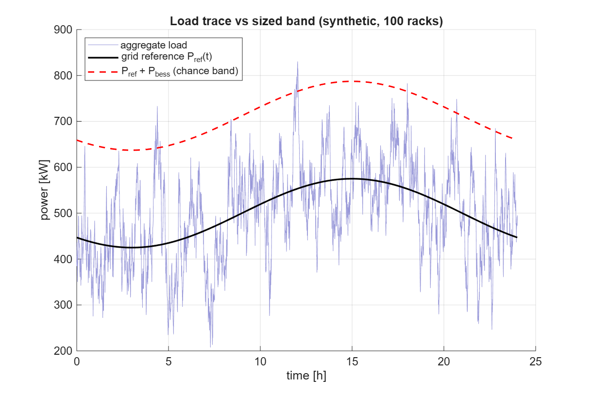
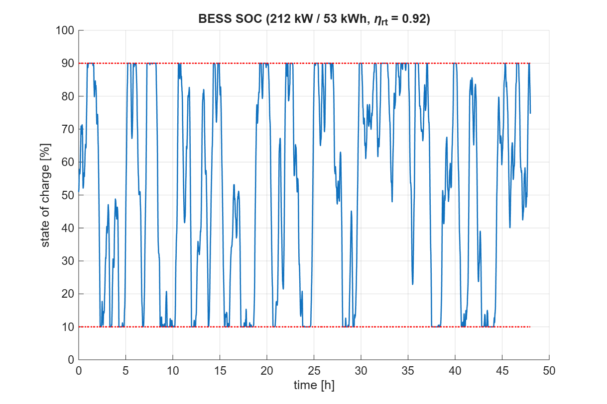

# BESS-Assisted Data-Center Capacity Planning

[](https://github.com/AdhritSingh21/bess-capacity-planning-research/actions/workflows/ci.yml)
[](LICENSE)

Price-optimal sizing of a grid-responsive data center using a two-layer
storage architecture — grid feed + battery energy storage (BESS) for slow
load fluctuations, per-rack supercapacitors for fast GPU bursts — with
reliability enforced through Gaussian chance constraints. A closed-form
sizing model is tested against a time-indexed dispatch simulation on
realistic synthetic load traces, a 9-scenario Monte Carlo study of the
chance constraint, and parameter sensitivity sweeps. The entire pipeline is
deterministic (seeded RNG), dependency-free (base MATLAB or GNU Octave, no
toolboxes), and regenerates every committed result byte-for-byte.

## Research context

Completed for graduate research credit under **Prof. Emre Koksal**,
The Ohio State University, **May–July 2026**, and published here with his
approval. The closed-form two-layer storage model is due to the research
group; this repository contributes the simulation and validation framework
built around it: synthetic trace generation, SOC/efficiency-aware dispatch,
sensitivity sweeps, Monte Carlo validation, and automated reporting.

## What the model does

Aggregate load over `N` equicorrelated racks is Gaussian with mean `N*mu`
and standard deviation `sigma_agg = sigma*sqrt(N*(1+(N-1)*rho))`. The
requirement "serve every instant" becomes the chance constraint

```
P[ load > P_ref + P_bess ] <= eps
```

which yields closed forms `P_bess = z * sigma_agg` with `z = Phi^-1(1-eps)`
(computed via `erfcinv`, so no Statistics Toolbox is needed) and
`C_bess = P_bess * tau_bess`. Per-rack supercapacitors carry fast bursts:
`C_sc = burst_amp * tau_sc`. The rack count `N` is enumerated as an integer
(no joint convexity assumed), and a demand floor `N*mu >= demand_total`
makes the optimum non-trivial. Units throughout: kW, kWh, hours, $.

The extension then asks the honest question: **does the closed-form design
actually work when dispatched against a realistic trace?** A simulator with
SOC limits, round-trip efficiency, and power caps answers it, and a Monte
Carlo study checks the Gaussian quantile math empirically.

## Key results

| Result | Value |
|---|---|
| Baseline design (500 kW demand, eps = 1%) | 100 racks, 500 kW grid feed, **212.2 kW / 53.0 kWh BESS**, 0.05 kWh supercap per rack |
| Statistical multiplexing (rho = 0.2) | fluctuation band **54% smaller** than perfectly correlated racks — directly shrinking the BESS |
| Chance-constraint accuracy (Monte Carlo, 500k samples per scenario) | empirical violation within 3 standard errors of target in **8 of 9** (rho, eps) scenarios |
| Dispatch validation: band exceedance | 0.0075 vs the eps = 0.01 design bound ✓ |
| Dispatch validation: unmet load after SOC/efficiency limits | **15.1% of steps** — the power sizing is right, but the `C_bess = P_bess*tau_bess` energy-window heuristic under-sizes energy during persistent diurnal excursions |
| Correlation sensitivity | required BESS power grows from 46.5 kW (rho = 0) to 416.7 kW (rho = 0.8) — correlation destroys multiplexing |
| Cost structure | grid energy dominates 10-year total (~$5.4M); BESS price sensitivity is small in absolute terms but large relative to storage capex |

The unmet-load result is the central finding, not a bug: the marginal
chance constraint (power) validates cleanly, while the fixed 15-minute
energy window is the weak link — motivating energy sizing derived from the
measured fluctuation autocorrelation instead (see roadmap below).





*The SOC trace repeatedly pinning at the 10% floor (14.8% of all steps) is
the energy-window failure mode made visible.*

## Reproducibility

- Runs on **base MATLAB (R2019a+) or GNU Octave — no toolboxes**.
- All randomness is seeded (`seed_rng.m`); the full pipeline is
  deterministic. Re-running `run_summer_extension` regenerates every CSV in
  `outputs/` **bit-identically** (the summary report differs only in its
  timestamp line).
- Every number quoted above is produced by a command in this repository —
  nothing is hand-edited.
- CI runs both test suites on every push with the official
  [MATLAB GitHub Actions](https://github.com/matlab-actions) on a Linux
  runner (see badge above).

## How to run

```matlab
cd <this folder>

% original baseline (closed-form sizing, console report + figure)
run_capacity_planning

% full workflow: baseline -> traces -> dispatch -> sweeps -> Monte Carlo
% -> 8 figures -> text report   (~1-2 minutes)
run_summer_extension
```

To use **real data** instead of synthetic traces, drop a CSV named
`real_load_data.csv` (or `load_trace.csv`, or `data/load_trace.csv`) in
this folder: one header row, column 1 = time in hours, columns 2..end =
per-rack load in kW. It is picked up automatically.

## How to test

```matlab
test_capacity_planning       % "All capacity_planning tests passed."
test_summer_extension        % "All summer-extension tests passed."
```

`test_capacity_planning` checks the quantile math against known values,
the multiplexing limits (rho = 0 and rho = 1), constraint bindingness,
error/warning contracts, and input validation. `test_summer_extension`
additionally covers trace generation (shape, non-negativity, seed
reproducibility), dispatch invariants (SOC bounds, power limits, an exact
constructed violation-count case), sweep and Monte Carlo sanity, and
end-to-end figure/report generation. Both run in CI on every push.

## Repository layout

| File | Role |
|---|---|
| `capacity_planning.m` | Core closed-form model |
| `run_capacity_planning.m` | Baseline driver |
| `test_capacity_planning.m` | Baseline test suite |
| `config_summer.m` | All extension parameters in one place |
| `generate_load_traces.m` | Synthetic rack traces, or auto-load of real CSV |
| `simulate_bess_dispatch.m` | Time-indexed dispatch with SOC/efficiency |
| `run_sensitivity_sweeps.m` | Parameter sweeps + rho×eps cost grid |
| `monte_carlo_validation.m` | Empirical test of the chance constraint |
| `make_summer_plots.m` | 8 figures → `outputs/figures/` |
| `write_summary_report.m` | Text report → `outputs/summary_report.txt` |
| `run_summer_extension.m` | Master script: full workflow end-to-end |
| `test_summer_extension.m` | Tests for all extension modules |
| `write_csv.m`, `seed_rng.m` | Small portability helpers |

## Outputs

Committed under `outputs/` as part of the reproducible record:

```
outputs/
  synthetic_load_traces.csv   time, aggregate (total/slow/burst), forecast,
                              first 5 per-rack columns
  dispatch_timeseries.csv     load, grid reference, BESS power, SOC, unmet
  sensitivity_results.csv     one row per scenario (sweep_id decodes:
                              1 rho, 2 eps, 3 c_bess_P, 4 c_bess_E,
                              5 demand, 6 fixed N, 7 rho×eps grid)
  monte_carlo_validation.csv  empirical vs target violation probability
  summary_report.txt          plain-text findings, limitations, next steps
  figures/*.png               8 figures (cost vs N, multiplexing, BESS vs
                              rho, rho×eps heatmap, trace vs band, SOC,
                              violation vs eps, BESS price sensitivity)
```

## Why this matters

AI data centers are becoming some of the largest and fastest-swinging loads
on the grid: GPU clusters can move hundreds of kilowatts in seconds, and
utilities increasingly require large loads to hold a committed power band.
Co-locating storage is the standard answer, but storage is capital — and
oversizing it wastes exactly the money it was meant to save. This project
quantifies two levers that decide the storage bill: **statistical
multiplexing** (uncorrelated racks cancel each other's fluctuations — a 54%
band reduction at rho = 0.2) and **the split between power and energy
sizing** (the power rating follows cleanly from a chance constraint, while
the energy rating is where naive heuristics fail). The validation framework
demonstrates the discipline that matters in energy systems work: closed-form
designs are cheap to compute, but they must be stress-tested in
time-indexed dispatch before anyone buys hardware.

## Assumptions and limitations

- Marginal (per-instant) chance constraint — no joint interval guarantee;
  the dispatch simulation partially covers this gap.
- `C_bess = P_bess*tau_bess` is a window heuristic, not spectrum-derived
  (and the dispatch results show exactly where it breaks).
- Gaussian loads clipped at zero; real workloads are heavier-tailed.
- Flat tariff; no demand charges, TOU pricing, or battery degradation.
- Supercaps assumed to absorb all fast bursts perfectly (fast layer is
  sized deterministically, not validated in the dispatch loop).
- Synthetic-trace parameters are illustrative until fitted to real traces.

## Roadmap

1. Fit `mu`, `sigma`, `rho`, and burst statistics from real rack/GPU traces.
2. Derive `C_bess` from measured fluctuation autocorrelation instead of a
   fixed window.
3. Add an interval/joint chance constraint and re-validate empirically.
4. Add TOU tariffs + demand charges; re-run the sweeps.
5. Model degradation via cycle counting on the dispatch throughput.

## License

[MIT](LICENSE) — Copyright (c) 2026 Adhrit Singh.
